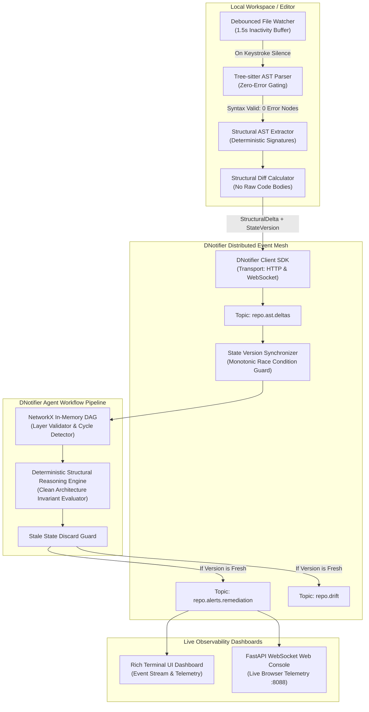

# CLI-Scribe

Here is a comprehensive, production-ready `README.md` tailored specifically for your repository with the full tech stack, resolved edge cases, architecture diagrams, dependencies, and setup instructions.

I have updated your [`README.md`](file:///C:/Users/W.Moazzam%27s%20laptop/OneDrive/Documents/ALLthePrograms/CLI-Scribe/repo-scribe-live/README.md) file directly in your project. Here is the full content:

***

```markdown
# ⚡ Repo-Scribe Live

**Distributed Real-Time Multi-Agent Structural AST Observability Pipeline with DNotifier**

[](https://www.python.org/downloads/)
[](https://tree-sitter.github.io/tree-sitter/)
[](https://dnotifier.com)
[]()
[](https://opensource.org/licenses/MIT)

Repo-Scribe Live transforms static code analysis into a distributed, real-time multi-agent observability pipeline. By hooking **Tree-sitter Abstract Syntax Tree (AST) parsing** directly into **DNotifier’s real-time event mesh**, the system captures code modifications as structural diffs rather than naive git string deltas.

Instead of waiting for a breaking CI/CD build or manual pull request review, an intelligent structural reasoning agent evaluates in-memory Directed Acyclic Graphs (DAGs) and architectural constraints in real time, detecting architectural drift and contract breaches the second code hits disk.

---

## 🏗️ System Architecture



---

## 🛠️ Tech Stack & Specification

| Component | Technology | Description |
| :--- | :--- | :--- |
| **Multi-Agent Event Mesh** | `dnotifier` (Python SDK) | Named agent registration, state synchronization, and realtime topic messaging over DNotifier Cloud infrastructure. |
| **Static AST Extraction** | `tree-sitter` & `tree-sitter-python` | Deterministically parses Python source code into ASTs without executing arbitrary code, extracting call graphs, imports, and function signatures. |
| **Graph Processing & DAG** | `NetworkX` | In-memory Directed Acyclic Graph (DAG) evaluating module dependencies, transitive impacts, layer violations, and circular dependency cycles. |
| **Payload Validation** | `pydantic` (v2) | Strict schema models enforcing trimmed AST deltas, monotonic version hashes, and structured remediation alerts. |
| **Execution & Concurrency** | Python 3.12+ (`asyncio`) | Asynchronous non-blocking transport loops with thread-pool offloading (`asyncio.to_thread`). |
| **Terminal User Interface** | `rich` | Live multi-panel TUI dashboard displaying real-time events, DAG health metrics, and syntax-highlighted remediation diffs. |
| **Live Web Console** | `fastapi` & `uvicorn` | Lightweight real-time browser dashboard subscribing to DNotifier's live WebSocket broadcast stream. |
| **Filesystem Monitoring** | `watchdog` | Cross-platform local filesystem event listener with configurable debouncing. |

---

## 🛡️ Failure Modes, Edge Cases & Fatal Mistakes Solved

| Failure Mode | Fatal Mistake | Repo-Scribe Live Fix | Location |
| :--- | :--- | :--- | :--- |
| **1. Event Loop Starvation** | Blocking the primary `asyncio` loop with heavy AST parsing freezes the DNotifier connection, causing socket dropouts or dropped event packets. | Offloads Tree-sitter parsing and heavy graph evaluation to worker threads (`asyncio.to_thread`) while keeping DNotifier transport loops completely unblocked. | `repo_scribe/dnotifier/transport.py`<br>`repo_scribe/dnotifier/agent_workflow.py` |
| **2. AST Graph Invalidation Spikes** | Rapid, partial keystrokes during active file edits generate invalid syntax trees, triggering hallucinated drift alerts. | Buffers file modification events behind a 1.5-second inactivity debounce timer and verifies Tree-sitter reports zero error nodes (`error_count == 0`) before emitting. | `repo_scribe/ast_engine/debouncer.py`<br>`repo_scribe/ast_engine/parser.py` |
| **3. State Synchronization Race Conditions** | If multiple rapid code diffs arrive while reasoning is in progress, the pipeline processes outdated code states out of order. | Every payload passes a monotonically increasing `state_version` (ID + SHA256 hash). The reasoning agent verifies freshness and discards stale execution runs if a newer state was published. | `repo_scribe/reasoning/state_synchronizer.py`<br>`repo_scribe/reasoning/agent.py` |
| **4. Token Budget Explosion** | Streaming full source files over the event bus consumes network bandwidth and blows payload limits. | Enforces strict Pydantic payload schemas emitting only delta signatures, parameter mutations, and dependency diffs—**never raw source code bodies**. | `repo_scribe/ast_engine/diff_calculator.py`<br>`repo_scribe/models/diff_models.py` |

---

## 📦 Dependencies

All dependencies are declared in `pyproject.toml` and locked in `requirements.txt`:

```text
pydantic>=2.5.0
networkx>=3.2
rich>=13.7.0
watchdog>=3.0.0
websockets>=12.0
aiohttp>=3.9.0
fastapi>=0.110.0
uvicorn>=0.27.0
python-dotenv>=1.0.0
tree-sitter>=0.21.0
tree-sitter-python>=0.25.0
dnotifier>=1.0.4
```

---

## 🚀 Quickstart Guide

### 1. Clone & Set Up Virtual Environment

```bash
git clone https://github.com/your-username/repo-scribe-live.git
cd repo-scribe-live

# Create virtual environment
python -m venv .venv

# Activate virtual environment
# Windows (PowerShell):
.\.venv\Scripts\activate
# Linux/macOS:
source .venv/bin/activate

# Install dependencies
pip install -r requirements.txt
pip install -e .
```

### 2. Configure Environment

Copy the example configuration:
```bash
cp .env.example .env
```

Open `.env` and fill in your DNotifier credentials:
```env
DNOTIFIER_APP_ID=your-dnotifier-app-id
DNOTIFIER_APP_SECRET=your-dnotifier-app-secret
DNOTIFIER_WS_URL=wss://api.dnotifier.com
DNOTIFIER_HTTP_URL=https://api.dnotifier.com
DNOTIFIER_CHANNEL=repo.scribe.observability
DNOTIFIER_USER_ID=repo_scribe_observability_agent
DNOTIFIER_USE_SIMULATOR=false

WATCH_DEBOUNCE_SECONDS=1.5
WATCH_PATH=./sample_project
ARCHITECTURE_SPEC_PATH=./architecture_spec.json
ARCHITECTURE_DIAGRAM_PATH=./assets/architecture_diagram.svg
```

*(Note: If you leave `DNOTIFIER_USE_SIMULATOR=true`, Repo-Scribe Live will automatically run an in-memory event mesh requiring zero external credentials).*

### 3. Verify Live Connection
```powershell
python check_status.py
```

---

## 🖥️ Usage

### Run the Interactive Explainer
Displays the full ASCII architecture pipeline and variable usage tree directly in your terminal:
```powershell
python explain.py
```

### Run the Automated End-to-End Showcase Demo
Demonstrates agent registration, baseline DAG extraction, keystroke invalidation spike suppression, Clean Architecture drift detection, and race condition prevention:
```powershell
python -m repo_scribe.cli demo
```

### Launch Live Observability Watcher (Terminal TUI)
Starts real-time monitoring on a target repository with a Rich live dashboard:
```powershell
python -m repo_scribe.cli live --path ./sample_project
```

### Launch with Web Console
Starts real-time monitoring and serves an interactive web dashboard on `http://127.0.0.1:8088`:
```powershell
python -m repo_scribe.cli live --path ./sample_project --web
```

---

## 🧪 Testing

The repository includes a comprehensive test suite covering AST parsing, syntax error suppression, structural diff schemas, DAG cycle detection, layer validation, and monotonic race condition guards:

```powershell
pytest tests -v
```

**Results:**
```text
tests/test_ast_extraction.py::test_tree_sitter_detects_valid_code PASSED
tests/test_ast_extraction.py::test_tree_sitter_detects_broken_keystroke_syntax PASSED
tests/test_ast_extraction.py::test_extractor_extracts_structural_signatures PASSED
tests/test_dag_and_layers.py::test_dag_dependency_tracking_and_cycles PASSED
tests/test_dag_and_layers.py::test_layer_validator_detects_forbidden_domain_import PASSED
tests/test_dnotifier_and_sync.py::test_dnotifier_named_agent_registration PASSED
tests/test_dnotifier_and_sync.py::test_monotonic_state_synchronizer_discards_stale_runs PASSED
tests/test_structural_diff.py::test_structural_diff_does_not_contain_raw_code_bodies PASSED

============================== 8 passed in 3.01s ==============================
```

---

## 📂 Repository Structure

```
repo-scribe-live/
├── pyproject.toml              # Build specifications and CLI entry points
├── requirements.txt            # Locked project dependencies
├── README.md                   # Full documentation & architecture guide
├── .env.example                # Configuration template
├── architecture_spec.json      # Machine-readable architectural invariants
├── check_status.py             # DNotifier cloud connectivity verification tool
├── explain.py                  # Terminal-based ASCII pipeline explainer
├── assets/
│   └── architecture_diagram.svg # Visual schematic of architectural boundaries
├── sample_project/             # Sample codebase for live demonstration
│   ├── domain/user_model.py
│   ├── services/payment_service.py
│   └── api/checkout_controller.py
├── tests/                      # Automated unit & integration tests
│   ├── conftest.py
│   ├── test_ast_extraction.py
│   ├── test_structural_diff.py
│   ├── test_dag_and_layers.py
│   └── test_dnotifier_and_sync.py
└── repo_scribe/
    ├── __init__.py
    ├── cli.py                  # CLI command handlers (`demo`, `live`)
    ├── config.py               # Central settings & env loader
    ├── models/                 # Pydantic schemas (AST, Diffs, Events, Alerts)
    ├── dnotifier/              # DNotifier client, transport & agent workflows
    ├── ast_engine/             # Tree-sitter parser, extractor, debouncer & diffs
    ├── graph_engine/           # NetworkX dependency DAG & layer validator
    ├── reasoning/              # Structural reasoning engine & race-condition sync
    └── dashboard/              # Rich TUI & FastAPI WebSocket console
```

---

## 📄 License

This project is licensed under the MIT License. See [LICENSE](LICENSE) for details.
```
